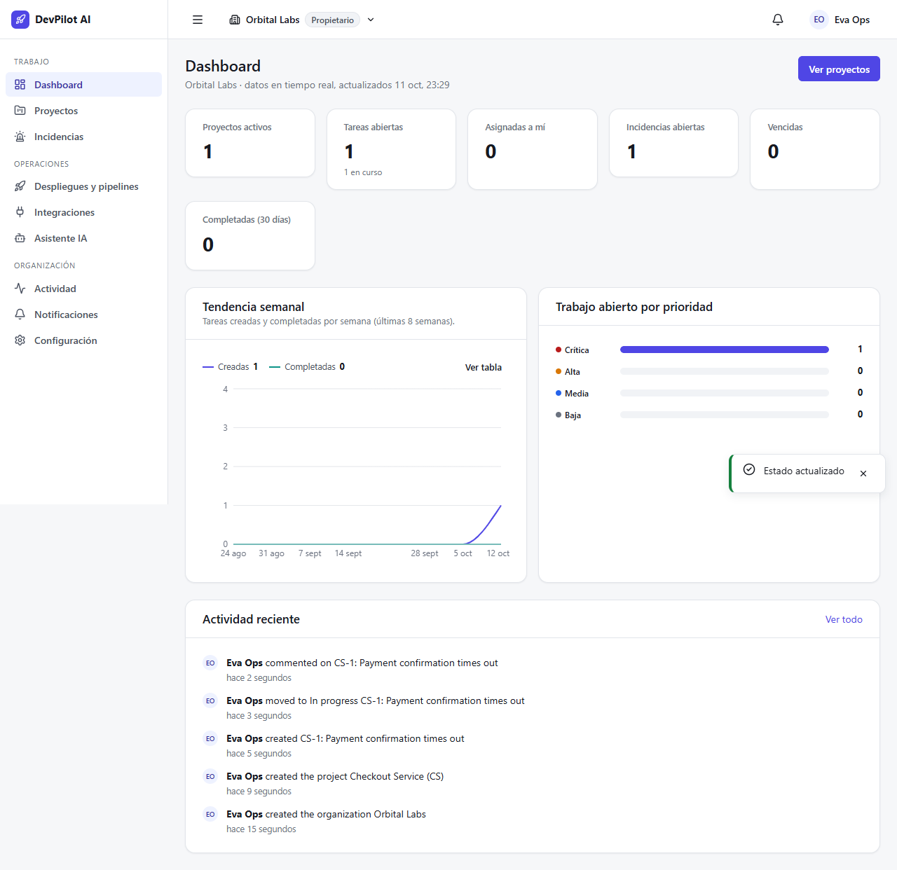

# DevPilot AI

Multi-tenant engineering operations platform: organizations, projects and a work-item board, GitHub webhook and log ingestion, incidents, notifications, and an AI assistant for log analysis and incident summaries over data the user is authorized to see.



## Architecture

| Component | Path | Stack |
|---|---|---|
| API | `src/backend` | .NET 10, ASP.NET Core minimal APIs, EF Core + PostgreSQL (Npgsql), FluentValidation, OpenTelemetry, Scalar API docs |
| Web app | `src/frontend` | React 19, TypeScript, Vite, TanStack Query, React Router, React Hook Form + Zod, Recharts |
| AI service | `src/python-ai-service` | Python 3.12, FastAPI, Pydantic, Anthropic SDK with a deterministic heuristic fallback |
| Contracts | `contracts` | OpenAPI contract and JSON fixtures shared by the API and the AI service |
| Tests | `tests/backend`, `src/frontend`, `src/python-ai-service/tests` | xUnit unit + integration tests, Vitest + Testing Library, Playwright, pytest |

Clean-architecture layering in the backend: `Domain` → `Application` → `Infrastructure` → `Api`.

## Running locally

Requirements: .NET 10 SDK, Node.js 22+, Python 3.12+, PostgreSQL 16+.

1. **Database** – create a local PostgreSQL database and user matching the connection string in `src/backend/DevPilot.Api/appsettings.Development.json` (dev-only credentials), or override it with the `ConnectionStrings__Postgres` environment variable. Migrations run on startup in Development.

2. **API** (http://127.0.0.1:5080, docs at `/scalar`):
   ```bash
   dotnet run --project src/backend/DevPilot.Api
   ```

3. **AI service** (http://127.0.0.1:8100):
   ```bash
   cd src/python-ai-service
   python -m venv .venv && .venv/Scripts/activate   # source .venv/bin/activate on macOS/Linux
   pip install -e ".[dev]"
   cp .env.example .env                             # optional: set ANTHROPIC_API_KEY
   uvicorn app.main:get_app --factory --host 127.0.0.1 --port 8100
   ```
   Without `ANTHROPIC_API_KEY` the service uses its heuristic provider, so everything works offline.

4. **Web app** (http://127.0.0.1:5173, proxies `/api` to the API):
   ```bash
   cd src/frontend
   npm ci
   npm run dev
   ```

## Tests and checks

```bash
dotnet test DevPilot.slnx                     # backend unit + integration tests (needs PostgreSQL)

cd src/frontend
npm run lint && npm run typecheck && npm test  # ESLint, TypeScript, Vitest
npx playwright test                            # end-to-end (needs the full stack running)

cd src/python-ai-service
ruff check . && mypy && pytest
```

## Configuration

| Setting | Where | Notes |
|---|---|---|
| `ConnectionStrings:Postgres` | API | Empty in `appsettings.json`; set per environment. |
| `Secrets:EncryptionKey` | API | Base64 32-byte key that encrypts integration secrets at rest. The value in `appsettings.Development.json` is for local development only — generate a new one for any real deployment. |
| `AiService:BaseUrl`, `AiService:ApiKey` | API | Address of the AI service and the shared internal key (must equal `AI_INTERNAL_API_KEY`). |
| `AI_*`, `ANTHROPIC_API_KEY` | AI service | See `src/python-ai-service/.env.example`. |
| `DEVPILOT_API_URL` | Web app (dev server) | API target for the Vite proxy; defaults to `http://127.0.0.1:5080`. |

> All credentials committed in `appsettings.Development.json` are local-development placeholders, not production secrets.


